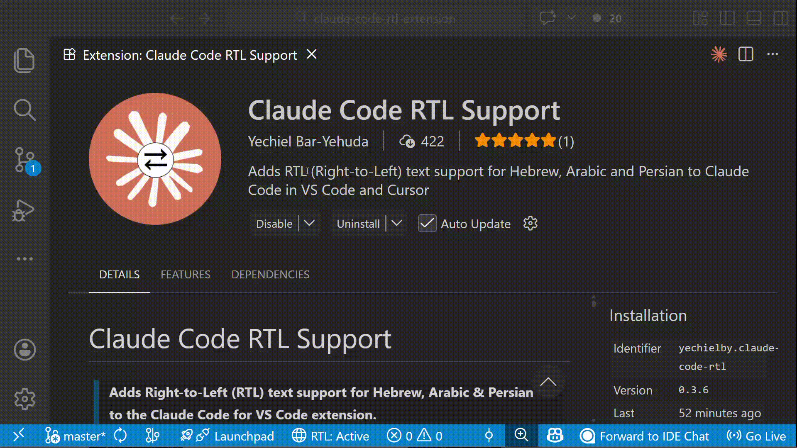

# دعم العربية (RTL) لـ Claude Code

تعرض محادثة **Claude Code** بالعربية من اليمين إلى اليسار، مع بقاء الكود كما هو.
تعمل على VS Code و Cursor و Antigravity و Kiro.

### 🎬 عرض توضيحي

### 🚀 الاستخدام

اسهل من قراءة هذا الوصف.

